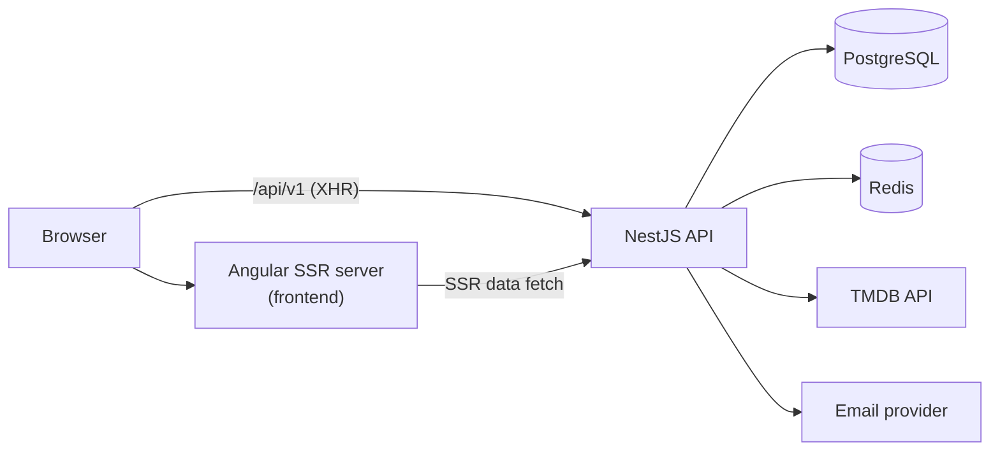

# Cinevault: Technical Requirements Document (TRD)

Scope and behavior: `docs/PRD.md`. Data and API contract: `docs/backend-schema.md`. Screens: `docs/app-flow.md` and `docs/ux-design-brief.md`.

## 1. Architecture

- One repo, two apps: `backend/` (NestJS) and `frontend/` (Angular with SSR). No shared package at the start; the API contract in `docs/backend-schema.md` is the shared definition.
- The browser talks to the API on the same site (reverse proxy or same domain, path `/api/v1`) so the refresh cookie is first-party. In development the Angular dev server proxies `/api` to `http://localhost:3000`.
- TMDB is called only from the API. The browser never sees the TMDB token.

## 2. Stack and version policy

| Layer | Choice | Notes |
|---|---|---|
| Runtime | Node.js active LTS (22 or newer) | Pin in `.nvmrc` and `engines` |
| API | NestJS 11, TypeScript strict | REST, class-validator DTOs |
| ORM | Prisma 7 | `prisma-client` generator, `@prisma/adapter-pg`, `prisma.config.ts` holds the datasource URL |
| DB | PostgreSQL (latest supported by the host) | |
| Cache | Redis via `@nestjs/cache-manager` + `@keyv/redis` | In-memory store as fallback if Redis is down |
| Auth | `@nestjs/jwt`, `argon2`, opaque refresh tokens | No Passport needed |
| Rate limit | `@nestjs/throttler` | |
| Email | `nodemailer` against SMTP (Mailpit locally) with a Resend SMTP or API transport in production | One `MailService` interface |
| Frontend | Angular (latest stable at scaffold, created with `ng new --ssr`), standalone components, signals, lazy routes | |
| UI components | PrimeNG (styled mode, dark only) + `primeicons` | Use PrimeNG components instead of building our own. Themed with a custom preset built on Aura (`src/app/theme/cinevault-preset.ts`). Docs checked on 2026-11-09 against PrimeNG v20; use the PrimeNG major that supports the installed Angular major. |
| Styling | Tailwind CSS v4 (CSS-first, `@tailwindcss/postcss`) + `tailwindcss-primeui` | All layout and styling through utility classes in templates. Design tokens live in `src/styles/theme.css` (`@theme`). No hand-written component CSS unless unavoidable. |
| Client state | NgRx SignalStore (`@ngrx/signals`, `@ngrx/operators`) | Only where section 4.2 says; everything else uses plain signals or resources. |
| Tests | Backend: Jest + Supertest against a real Postgres and Redis (Docker). Frontend: the CLI's default unit runner. E2E smoke: Playwright | |
| Local infra | `docker-compose.yml` with postgres, redis, mailpit | |

Use the latest stable majors at scaffold time. Where this document names an API (Prisma generator, cache-manager Redis store, Angular SSR) it was checked against current docs on 2026-11-09; re-check if a major changed.

## 3. Backend design

### 3.1 Modules

`ConfigModule` (validated env), `PrismaModule`, `CacheModule` (global), `MailModule`, `AuthModule`, `UsersModule` (/me), `FavoritesModule`, `CatalogModule` (TMDB), `AdminModule`, `HealthModule`.

### 3.2 Cross-cutting

- Global `ValidationPipe` (`whitelist`, `forbidNonWhitelisted`, `transform`).
- Global exception filter produces `{statusCode, code, message}`.
- `helmet`, CORS allow-list from `WEB_ORIGIN`, `cookie-parser`, `trust proxy` configurable.
- Logging: structured, never logs passwords, tokens or Authorization headers.
- `JwtAuthGuard` (verifies access token and checks Redis `blocked:<id>`) and `RolesGuard` with `@Roles('ADMIN')`.

### 3.3 Auth design

- Passwords: argon2id; min 10 chars, max 128.
- Access token: JWT, 10 minutes, payload `{sub, role}`. Refresh token: 32 random bytes, base64url, stored as sha256 hash, 30 days, rotated on every refresh. Reuse of a revoked token revokes every token of that user.
- Email tokens: 32 random bytes, hash stored, single use, expiry per type (see schema doc).
- Responses for register, resend, forgot never reveal whether an email exists.
- Login order: find user, verify password, then check status (PENDING gives `EMAIL_NOT_VERIFIED`, BLOCKED gives `ACCOUNT_BLOCKED`). Do a dummy hash comparison for unknown emails to equalize timing.
- Blocking a user: revoke all refresh tokens and set `blocked:<id>` for 600 seconds; unblocking deletes the key.

### 3.4 TMDB integration

- Base `https://api.themoviedb.org/3`, header `Authorization: Bearer ${TMDB_READ_TOKEN}`, `language=en-US`, `include_adult=false` on every list, search and discover call.
- `TmdbClient.get<T>(path, query)` handles timeouts (5s), one retry on 429 and 5xx (honoring `Retry-After`), and maps failures: 404 to `NotFoundException`, others to `BadGatewayException` with code `TMDB_UNAVAILABLE`.
- A mapper converts raw TMDB objects to the DTOs in the schema doc. Every nullable field (poster, backdrop, overview, release date, runtime) maps to `null`, never throws.
- Image URLs: `https://image.tmdb.org/t/p/{size}{path}`; poster `w342` (cards) and `w500` (detail), backdrop `w1280`. Size constants live in one file.
- Page numbers clamp to 1 to 500 (TMDB maximum); an out-of-range `page` returns 400.
- Details use one call with `append_to_response=credits,videos,similar` (movies and series).

### 3.5 Caching

Cache the normalized DTO, keyed by `tmdb:<route>:<sorted query>`.

| Data | TTL |
|---|---|
| Title details, season details, genre lists, genre covers | 24h (5 min when a genre lookup failed) |
| Trending, popular, top rated, new, discover | 1h |
| Search | 10 min |

If Redis is down, the in-memory store serves as fallback (per-process) and a warning is logged; requests never fail because of the cache. Concurrent identical misses may each call TMDB (no single-flight at v1).

### 3.6 Configuration (env)

`NODE_ENV`, `PORT` (3000), `DATABASE_URL`, `REDIS_URL`, `TMDB_READ_TOKEN`, `TMDB_BASE_URL` (default `https://api.themoviedb.org/3`; overridden by tests), `JWT_ACCESS_SECRET`, `WEB_ORIGIN`, `COOKIE_SECURE`, `MAIL_FROM`, `SMTP_URL`, `FEATURE_DOWNLOAD_BUTTON` (default `false`), `THROTTLE_DISABLED` (default `false`, tests only), `SEED_ADMIN_EMAIL`, `SEED_ADMIN_PASSWORD` (the last two only needed by the seed script, not by the API). Startup fails fast with a clear message when a required variable is missing. `.env.example` is committed; real `.env` never is.

## 4. Frontend design

### 4.1 UI approach: PrimeNG + Tailwind

- **PrimeNG first.** If PrimeNG has a component for it, use it: Button, InputText, Password, FloatLabel, Select, SelectButton, Table, Dialog, ConfirmPopup, Toast, Message, Accordion, Avatar, Skeleton, Menu, Card, IconField. Build our own component only for what PrimeNG does not offer or where the owner chose to: `PosterCard`, `Rating`, `StateBlock` (composed from PrimeNG parts), and, by owner decision (2026-11-09), the **hero carousel** and the **paginator**, which are built from scratch with Tailwind and signals to match the design exactly. Page layouts are plain Tailwind.
- **Theme once, not per component.** The approved look (`docs/ux-design-brief.md`) is reproduced by (a) the Tailwind `@theme` tokens and (b) one PrimeNG preset (`definePreset(Aura, ...)`) that maps the same values: primary `#4C60C8`, the five dark surface steps, text colors, focus ring, 4/6/8px radii, Schibsted Grotesk. Dark mode only: `<html class="app-dark">` and `darkModeSelector: '.app-dark'`.
- **Layer order (Tailwind v4):** `providePrimeNG({theme: {preset, options: {darkModeSelector: '.app-dark', cssLayer: {name: 'primeng', order: 'theme, base, primeng'}}}})` so the `primeng` layer sits after Tailwind's `theme` and `base` and before its utilities; utilities then win over PrimeNG where we need them. `styles.css` imports `tailwindcss`, `tailwindcss-primeui`, `primeicons`, then `theme.css`.
- **Rule:** templates use Tailwind classes; PrimeNG look changes go through preset tokens (or `pt` pass-through for one-offs), never through global overrides with `!important`. A `styles:` block in a component needs a one-line justification comment.
- **Known risk:** PrimeNG components will not match the mockup pixel for pixel on day one (poster rows, table density; the hero carousel and paginator are custom so they are not at risk). Each UI task ends with a side-by-side check against the mockup; fixes go into the preset first. The poster row may fall back to a Tailwind scroll-snap container if `p-carousel` cannot match the mockup's behavior (documented in Task 14).
- **SSR:** PrimeNG works with Angular SSR; verify styles are present in the server-rendered HTML (plan Task 20).

### 4.2 State management: where NgRx SignalStore fits

Investigated 2026-11-09 against the NgRx Signals docs (`signalStore`, `withState`, `withComputed`, `withMethods`, `rxMethod`, `providedIn: 'root'` or component-level `providers`). Principle: use a SignalStore when state has several fields, derived values and methods that change it together. Do not use it for plain fetch-and-show.

| Case | Tool | Why |
|---|---|---|
| Session: user, access token, ready flag, login, logout, refresh | **SignalStore, root** (`AuthStore`) | Global, read by guards, interceptor and nav; has methods and computed (`isAdmin`) |
| Favorite keys with optimistic toggle and rollback | **SignalStore, root** (`FavoritesStore`) | Global, shared by every poster heart; optimistic update logic belongs with the state |
| Favorites page: type filter, page, items, pending removal with undo | **SignalStore, component-level** (`FavoritesPageStore`) | Many interacting fields; dies with the page |
| Admin users page: debounced search, page, items, per-row busy flags | **SignalStore, component-level** (`UsersPageStore`) | `rxMethod` with `debounceTime` and `switchMap` is exactly the documented pattern |
| Read-only data bound to route params (home rows, title detail, browse grids, search results, admin overview) | **`rxResource`** (or `httpResource`) | One signal with value, loading and error and `reload()`; a store would only duplicate this. Confirm the API is stable in the installed Angular version; if it is still experimental, use a small component-level SignalStore with `rxMethod` instead |
| Carousel index, accordion, dialog open state | Plain signals | Local UI state |
| Forms | Reactive forms with PrimeNG inputs | Validation and dirty tracking come with forms |
| Public config flags | Plain service with a signal (`ConfigService`) | One value, loaded once |

Rules: stores hold serializable state (arrays and plain objects, not `Set` or class instances); the server renders as a visitor so `AuthStore` restores the session in the browser only; no store for things the router already owns (the current page and `q` live in the URL); no extra libraries (no ngrx-toolkit, no Redux DevTools) until a real need appears.

### 4.3 Structure and behavior

- Standalone components, signals for state, `inject()` for DI, lazy-loaded route groups: `public`, `auth`, `dashboard`, `admin`.
- `ApiClient` wraps `HttpClient` with base `/api/v1`. An interceptor adds the bearer token, and on a 401 calls `/auth/refresh` once (shared promise so concurrent requests do not refresh twice) and retries; on failure it clears the session and routes to `/login?next=`.
- `AuthStore` (root SignalStore) holds `user` and the in-memory access token; `restoreSession()` runs once at app start in the browser only.
- Guards: `authGuard`, `guestGuard`, `adminGuard`.
- SSR: public routes render on the server using the API; set per-title `<title>`, description, canonical and Open Graph tags via `Title` and `Meta`. Use Angular's HTTP transfer cache so the browser does not refetch what SSR already loaded. Authenticated areas render a shell on the server and load data in the browser.
- Images use `loading="lazy"` except the hero image (`fetchpriority="high"`), with explicit width and height or `aspect-ratio` to prevent layout shift.
- Server-side env: the SSR server calls the API using `API_INTERNAL_URL`.

## 5. Security requirements

- Access token never stored in `localStorage` or cookies; refresh token httpOnly, Secure, SameSite=Lax.
- CSRF: the refresh endpoint is the only cookie-authenticated mutation; it requires `Content-Type: application/json` and the `Origin` header must match `WEB_ORIGIN`.
- No secrets in the repo; `TMDB_READ_TOKEN` and secrets only in env.
- Input validated at every boundary; output never includes `passwordHash`.
- Authorization checked in the service layer for admin actions (self-action and last-admin rules) as well as by the guard.
- Dependencies: `npm audit` clean of high or critical findings before launch.

## 6. Performance targets

- API p95 under 150ms for cached catalog reads, under 800ms for cache misses.
- Home and Title pages: LCP under 2.5s (4G, mid-range phone), CLS under 0.1.
- SSR pages cached by the CDN or reverse proxy for visitors (`Cache-Control: public, s-maxage=300, stale-while-revalidate=600`) on catalog routes; never on authenticated routes.

## 7. Testing strategy

- Backend: unit tests for pure logic (mapper, token utilities, rules), e2e tests with Supertest on a throwaway Postgres schema and a Redis database for every endpoint's success and key failure paths. TMDB is stubbed with a fake HTTP server or `nock`-style interceptor; no test calls the real TMDB.
- Frontend: unit tests for stores (SignalStore tests run in `TestBed`), interceptor, guards and components with logic; no snapshot tests. Do not test PrimeNG internals; test our behavior around it.
- E2E smoke (Playwright, one spec): register (read the verification link from Mailpit's API), login, favorite a title, see it on the Favorites page, log out; and admin blocks a user. TMDB stubbed by running the API with `TMDB_BASE_URL` pointing at a stub server.
- CI runs lint, backend tests, frontend tests, and the build for both apps.

## 8. Deployment (decision deferred)

Hosting is not decided. Requirements: Node runtime for the API and the Angular SSR server, managed PostgreSQL, managed Redis, HTTPS, a single domain with `/api` routed to the API, an email provider with a verified sending domain. Config via env vars. Run Prisma migrations as a deploy step (`prisma migrate deploy`).

## 9. Open technical items

- Email provider final choice (Resend assumed).
- Hosting provider.
- TMDB commercial-license answer (owner), which could change the data source.
