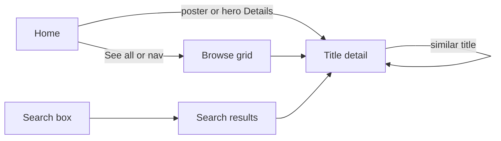
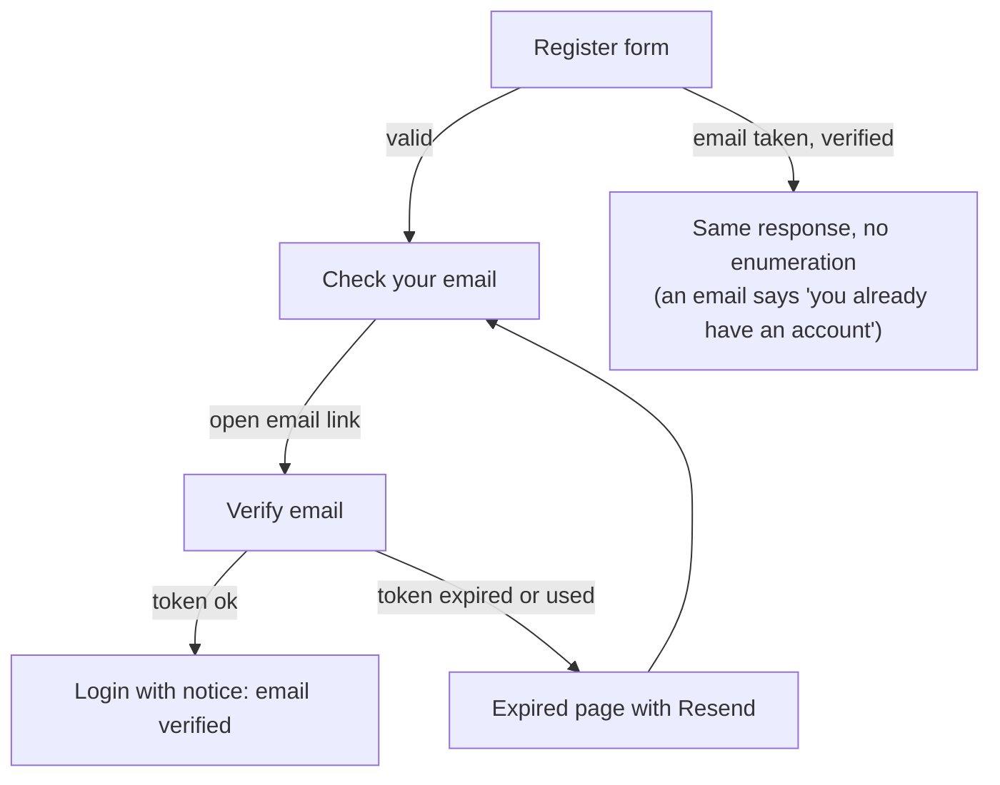
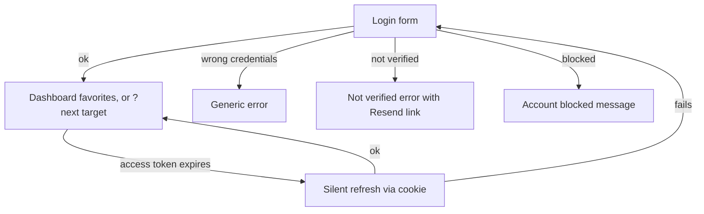

# Cinevault: App Flow

Screens and transitions. Screen names match the approved mockup (`docs/design/directions/a2-streamline-premium.html`). Routes are the Angular routes.

## 1. Route map

| Route | Screen | Access |
|---|---|---|
| `/` | Home | Public |
| `/movies`, `/tv` | Browse movies / series | Public |
| `/new` | New & Popular | Public |
| `/genre/:type/:id` | Genre results | Public |
| `/search?q=` | Search results | Public |
| `/title/:type/:id` | Title detail (`type` = `movie` or `tv`) | Public |
| `/login`, `/register`, `/forgot-password` | Auth | Guests only (logged-in users are redirected to `/dashboard/favorites`) |
| `/check-email` | "Check your email" after register or resend | Public |
| `/verify-email?token=` | Verifies an email token | Public |
| `/reset-password?token=` | Set a new password | Public |
| `/dashboard/favorites` | My favorites | Logged in |
| `/dashboard/account` | Account settings | Logged in |
| `/admin/users` | Manage users | Admin |
| `/admin/overview` | Overview | Admin |
| `/terms`, `/privacy` | Terms and Privacy (placeholders until the owner supplies text) | Public |
| `**` | Not found | Public |

## 2. Navigation

- **Top nav (all public and dashboard-adjacent pages):** logo, Home, TV Shows, Movies, New & Popular, My List (goes to `/dashboard/favorites`, or to `/login?next=` for visitors), search box, Log in + Register (visitor) or avatar menu (Favorites, Account, Admin if admin, Log out).
- **Dashboard shell:** sidebar on laptop, bottom tab bar on phone. Items: Favorites, Account, plus Users and Overview for admins, Back to site, Log out.

## 3. Flows

### 3.1 Browse and view a title

### 3.2 Register and verify

### 3.3 Login and session

### 3.4 Forgot and reset password
Forgot form → always shows "If that email exists, a link was sent" → user opens link → `/reset-password?token=` → new password (and confirm) → success → Login. All the user's sessions are revoked.

### 3.5 Favorites
- On title page or poster hover: heart toggles. Visitor click → login prompt that returns to the same title after login.
- Favorites page: filter All / Movies / Series, remove with undo, empty state links to Home.

### 3.6 Account
- Edit name (saves inline).
- Change password: old, new, confirm. Wrong old password shows an inline error.
- Change email: enter new email and current password → verification email goes to the **new** address → email changes only after the link is opened.
- Delete account: type DELETE and enter password → account and favorites removed → redirected to Home.

### 3.7 Admin
- Users: search, change role (select), block/unblock (toggle), delete (inline confirm). Self-actions are disabled; last-admin protection shows an explanatory message.
- Overview: two figures and recent sign-ups, read-only.

## 4. States every data screen needs

| State | Behavior |
|---|---|
| Loading | Skeleton (posters, rows, table rows), no layout shift |
| Empty | A real sentence and a way forward (e.g. Favorites empty → Browse titles) |
| Error | Plain message with Retry; TMDB failures never show a blank page |
| Not found | Unknown title id → Not found page with link Home |
| Offline or slow | Retry button; no infinite spinners |

## 5. Session behavior

Access token (10 min) is held in memory only. Refresh token is an httpOnly cookie. On page load, the app calls `/auth/refresh` once to restore the session. SSR pages render as a visitor; the user state fills in after hydration.
