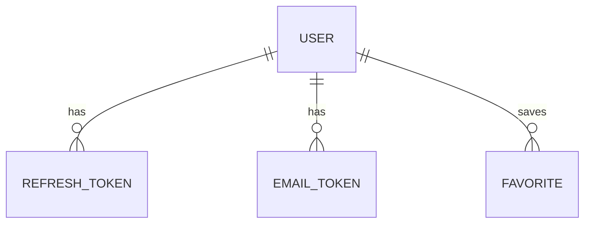

# Cinevault: Backend Schema and API Contract

Database: PostgreSQL. ORM: Prisma 7 (`prisma-client` generator, `@prisma/adapter-pg` driver adapter). Naming: tables snake_case via `@@map`, columns camelCase in the client.

## 1. Entities



There is no title table. Titles live at TMDB; favorites store only the TMDB id and type.

## 2. Prisma schema

```prisma
datasource db {
  provider = "postgresql"
}

generator client {
  provider = "prisma-client"
  output   = "../src/generated/prisma"
}

enum Role {
  USER
  ADMIN
}

enum UserStatus {
  PENDING   // registered, email not verified
  ACTIVE
  BLOCKED
}

enum MediaType {
  MOVIE
  TV
}

enum EmailTokenType {
  VERIFY_EMAIL
  RESET_PASSWORD
  CHANGE_EMAIL
}

model User {
  id              String       @id @default(uuid())
  email           String       @unique            // stored lowercase, trimmed
  name            String
  passwordHash    String
  role            Role         @default(USER)
  status          UserStatus   @default(PENDING)
  emailVerifiedAt DateTime?
  createdAt       DateTime     @default(now())
  updatedAt       DateTime     @updatedAt

  refreshTokens   RefreshToken[]
  emailTokens     EmailToken[]
  favorites       Favorite[]

  @@index([createdAt])
  @@index([role, status])
  @@map("users")
}

model RefreshToken {
  id         String    @id @default(uuid())
  userId     String
  tokenHash  String    @unique                    // sha256 of the opaque token
  expiresAt  DateTime
  revokedAt  DateTime?
  createdAt  DateTime  @default(now())
  user       User      @relation(fields: [userId], references: [id], onDelete: Cascade)

  @@index([userId])
  @@map("refresh_tokens")
}

model EmailToken {
  id         String         @id @default(uuid())
  userId     String
  type       EmailTokenType
  tokenHash  String         @unique
  newEmail   String?                              // only for CHANGE_EMAIL
  expiresAt  DateTime
  usedAt     DateTime?
  createdAt  DateTime       @default(now())
  user       User           @relation(fields: [userId], references: [id], onDelete: Cascade)

  @@index([userId, type])
  @@map("email_tokens")
}

model Favorite {
  id         String     @id @default(uuid())
  userId     String
  tmdbId     Int
  mediaType  MediaType
  createdAt  DateTime   @default(now())
  user       User       @relation(fields: [userId], references: [id], onDelete: Cascade)

  @@unique([userId, mediaType, tmdbId])
  @@index([userId, createdAt])
  @@map("favorites")
}
```

Notes:
- `onDelete: Cascade` makes "delete my account" remove tokens and favorites in one statement.
- Email is lowercased and trimmed in the service before every read and write so the plain unique index is enough.
- Token lifetimes: refresh 30 days; VERIFY_EMAIL 24h; RESET_PASSWORD 1h; CHANGE_EMAIL 24h. Only a sha256 hash of each opaque token is stored.
- Seed: `prisma/seed.ts` creates one ADMIN (`ACTIVE`, verified) from `SEED_ADMIN_EMAIL` and `SEED_ADMIN_PASSWORD`.

## 3. Redis keys

| Key | Value | TTL |
|---|---|---|
| `tmdb:<path>?<sorted query>` | cached TMDB JSON (normalized) | per endpoint, see TRD |
| `blocked:<userId>` | `1` | access token lifetime (600s); set on block, deleted on unblock |
| `throttle:*` | rate-limit counters | managed by the throttler |

## 4. API contract

Base path `/api/v1`. JSON. Errors: `{ "statusCode": number, "code": string, "message": string }`. Auth: `Authorization: Bearer <accessToken>`. Refresh token: cookie `cv_refresh` (httpOnly, Secure in production, SameSite=Lax, path `/api/v1/auth`).

### Shared shapes

```ts
type MediaTypeParam = 'movie' | 'tv';

interface TitleSummary {
  tmdbId: number; mediaType: MediaTypeParam; title: string;
  year: number | null; rating: number | null;      // rating 0-10, one decimal
  posterUrl: string | null; backdropUrl: string | null; overview: string | null;
}

interface Paged<T> { items: T[]; page: number; totalPages: number; totalItems: number }

interface UserDto {
  id: string; email: string; name: string;
  role: 'USER' | 'ADMIN'; status: 'PENDING' | 'ACTIVE' | 'BLOCKED';
  createdAt: string;
}
```

### Public

| Method and path | Purpose | Response |
|---|---|---|
| `GET /health` | Liveness | `{status:'ok'}` |
| `GET /config` | Public flags | `{features:{downloadButton:boolean}}` |
| `GET /catalog/trending?type=movie\|tv` | Trending this week | `Paged<TitleSummary>` |
| `GET /catalog/popular?type=` | Popular | `Paged<TitleSummary>` |
| `GET /catalog/top-rated?type=` | Top rated | `Paged<TitleSummary>` |
| `GET /catalog/new?type=` | Now playing (movie) or on the air (tv) | `Paged<TitleSummary>` |
| `GET /catalog/genres?type=` | Genre list | `{id:number,name:string}[]` |
| `GET /catalog/genre-covers?type=` | One card-size (w780) backdrop per genre, from its most popular titles, no title repeated; `coverUrl` is `null` when none; cached 24 h | `{id:number,name:string,coverUrl:string\|null}[]` |
| `GET /catalog/discover?type=&genre=&page=` | Titles by genre | `Paged<TitleSummary>` |
| `GET /catalog/search?q=&page=` | Search movies and series (`q` 1 to 100 chars) | `Paged<TitleSummary>` |
| `GET /catalog/:type/:id` | Title details | `TitleDetail` |
| `GET /catalog/tv/:id/season/:n` | Season episodes | `SeasonDetail` |

```ts
interface TitleDetail extends TitleSummary {
  tagline: string | null; runtimeMinutes: number | null; seasons: number | null;
  genres: {id:number,name:string}[]; status: string | null; originalLanguage: string | null;
  director: string | null;
  cast: {name:string, character:string|null}[];           // top 12
  trailerUrl: string | null;                               // https://www.youtube.com/watch?v=<key>
  similar: TitleSummary[];                                  // up to 12
  seasonList: {number:number, name:string, episodeCount:number}[];   // tv only
}
interface SeasonDetail { number:number; episodes:{number:number,name:string,airDate:string|null,overview:string|null}[] }
```

### Auth

| Method and path | Body | Result and errors |
|---|---|---|
| `POST /auth/register` | `{name,email,password}` | 202 `{message}` always (no account enumeration). Password min 10 chars, max 128. |
| `POST /auth/verify-email` | `{token}` | 204. 400 `TOKEN_INVALID` or `TOKEN_EXPIRED`. Also applies CHANGE_EMAIL tokens. |
| `POST /auth/resend-verification` | `{email}` | 202 always |
| `POST /auth/login` | `{email,password}` | 200 `{accessToken,user}` + refresh cookie. 401 `INVALID_CREDENTIALS`, 403 `EMAIL_NOT_VERIFIED`, 403 `ACCOUNT_BLOCKED` |
| `POST /auth/refresh` | cookie | 200 `{accessToken,user}`, rotates cookie. 401 `REFRESH_INVALID`. Reuse of a revoked token revokes all that user's tokens. |
| `POST /auth/logout` | cookie | 204, revokes token, clears cookie |
| `POST /auth/forgot-password` | `{email}` | 202 always |
| `POST /auth/reset-password` | `{token,newPassword}` | 204, revokes all refresh tokens. 400 token errors. |

### Me (auth required)

| Method and path | Body | Result and errors |
|---|---|---|
| `GET /me` | | `UserDto` |
| `PATCH /me` | `{name}` | `UserDto` |
| `POST /me/change-password` | `{oldPassword,newPassword}` | 204. 400 `OLD_PASSWORD_WRONG`. Revokes all refresh tokens; the client then logs the user out. |
| `POST /me/change-email` | `{newEmail,password}` | 202. 400 `PASSWORD_WRONG`. Sends verification to the new address. Always 202 for an already-used address. |
| `DELETE /me` | `{password}` | 204. 400 `PASSWORD_WRONG`. Last active admin gets 409 `LAST_ADMIN`. |
| `GET /me/favorites?type=&page=` | | `Paged<TitleSummary & {addedAt:string, unavailable?:boolean}>`, 20 per page, newest first |
| `GET /me/favorites/ids` | | `{mediaType,tmdbId}[]` (all, for heart state) |
| `PUT /me/favorites/:type/:tmdbId` | | 204, idempotent |
| `DELETE /me/favorites/:type/:tmdbId` | | 204, idempotent |

### Admin (role ADMIN)

| Method and path | Body | Result and errors |
|---|---|---|
| `GET /admin/users?q=&page=` | | `Paged<UserDto>`, 20 per page, newest first; `q` matches name or email, case-insensitive |
| `PATCH /admin/users/:id` | `{role?,status?}` (`status` is `ACTIVE` or `BLOCKED`) | `UserDto`. 409 `SELF_ACTION`, 409 `LAST_ADMIN`. Blocking revokes refresh tokens and sets `blocked:<id>`. |
| `DELETE /admin/users/:id` | | 204. 409 `SELF_ACTION`, 409 `LAST_ADMIN` |
| `GET /admin/overview` | | `{totalUsers:number,newThisWeek:number,recentSignups:UserDto[5]}` |

### Rate limits

Global 100 requests/minute/IP. `/auth/login`, `/auth/register`, `/auth/forgot-password`, `/auth/resend-verification`: 5/minute/IP. Exceeding returns 429 `RATE_LIMITED`.
